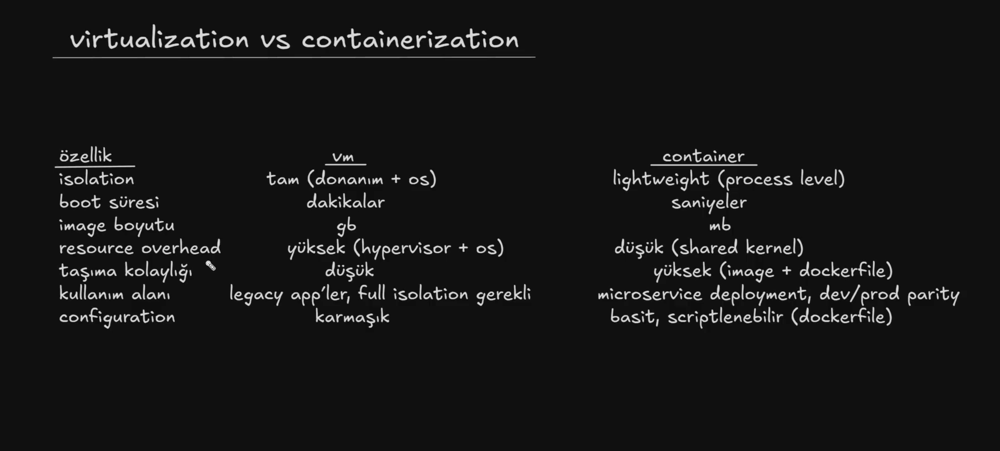
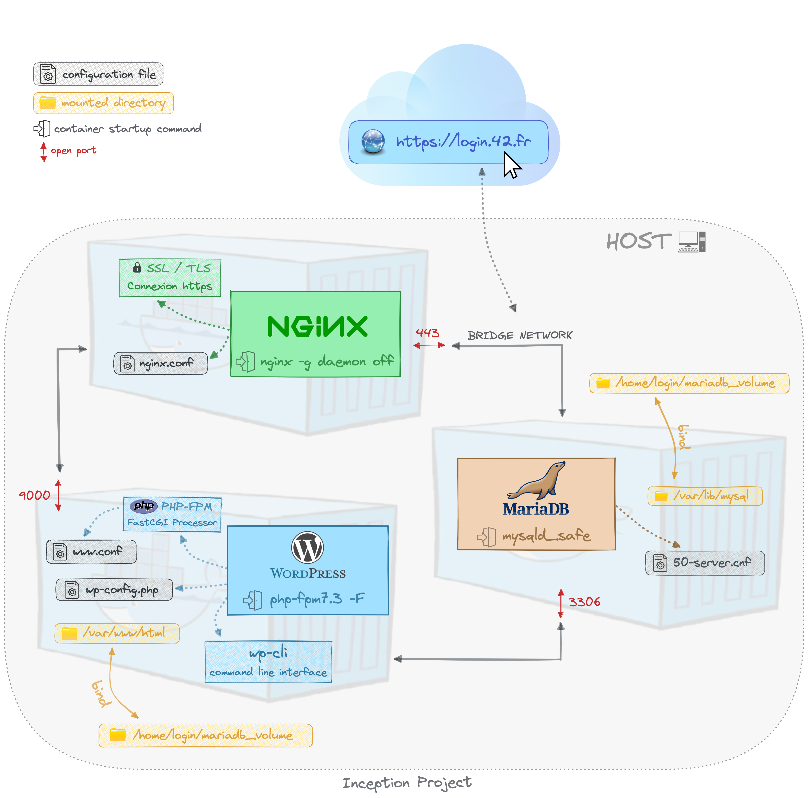

# Inception notlarım


### 1. İşletim Sistemi (Operating System) Nedir?
İşletim sistemi, donanım kaynaklarını (CPU, RAM, Disk, Ağ vb.) yöneten ve kullanıcı/uygulamalar ile donanım arasında köprü görevi gören en temel yazılımdır. Uygulamaların güvenli, izole ve çakışmadan çalışmasını sağlar.

---

### 2. Kernel (Çekirdek) Nedir?
İşletim sisteminin kalbidir. Donanımla (hardware) doğrudan konuşan tek katmandır. Süreç yönetimi (process management), bellek yönetimi (memory management), dosya sistemleri ve sistem çağrılarını (syscalls) kontrol eder. 
> **Önemli:** Docker konteynerları kendi kernel'ına sahip değildir; doğrudan ana makinenin (Host OS) Linux Kernel'ını ortaklaşa kullanırlar.
> **macOS / Windows notu:** Bu sistemlerde Linux kernel'ı yoktur. Docker Desktop arka planda küçük bir Linux VM çalıştırır; konteynerlar o VM'in kernel'ını paylaşır.

---

### 3. Sanallaştırma (Virtualization) Nedir?
Tek bir fiziksel donanım üzerinde, donanım kaynaklarını (CPU, RAM, Disk) yazılımsal olarak bölerek birden fazla bağımsız işletim sisteminin veya ortamın aynı anda çalıştırılması teknolojisidir.

---

### 4. Dependency Hell (Bağımlılık Cehennemi) Nedir ve Neden Bir Sunucuya 100 Tane App Kurmuyoruz?
Farklı uygulamaların aynı sunucuda çalışırken farklı kütüphane veya dil versiyonlarına ihtiyaç duymasıyla oluşan kaos durumudur (Örn: App A -> Python 2.7, App B -> Python 3.10 isterse çakışırlar).
**Neden direk 100 app kurmuyoruz?:**
* **Çakışma (Conflict):** Kütüphane ve port çakışmaları yaşanır.
* **Güvenlik (Security):** Bir uygulama hacklenirse veya çökerse, aynı işletim sistemindeki diğer 99 uygulama da tehlikeye girer.
* **Yönetilebilirlik:** Bir uygulamanın bağımlılığını güncellemek diğer uygulamaları bozabilir.

---

### 5. Container (Konteyner) Nedir?
Bir uygulamanın çalışması için gereken tüm kodları, kütüphaneleri, bağımlılıkları ve konfigürasyonları paketleyen izole bir yürütme ortamıdır (process). Konteynerlar işletim sistemini değil, **kernel'ı paylaşırlar**.

---

### 6. Hypervisor (Sanal Makine Yöneticisi) Nedir?
Fiziksel donanım üzerinde sanal makineler (VM) oluşturmayı, çalıştırmayı ve kaynaklarını yönetmeyi sağlayan yazılım veya donanım katmanıdır. 
* **Type 1 (Bare-metal):** Doğrudan donanıma kurulur (Örn: VMware ESXi, Proxmox).
* **Type 2 (Hosted):** Bir işletim sisteminin üzerine kurulur (Örn: VirtualBox, VMware Workstation).

---

### 7. Namespaces (İsim Alanları) Nedir?
Linux Kernel'ının sunduğu ve konteynerlara **İzolasyon (Görünürlük Sınırı)** sağlayan özelliktir. Konteynerın dış dünyayı görmesini engeller.
* **PID Namespace:** Süreçleri izole eder (Konteyner içindeki süreç kendini PID 1 görür).
* **NET Namespace:** Ağ kartlarını ve IP adreslerini izole eder.
* **MNT Namespace:** Dosya sistemini ve mount noktalarını izole eder.
* **IPC / UTS / USER Namespace:** İşlemler arası iletişimi, hostname'i ve kullanıcı yetkilerini izole eder.

---

### 8. Control Groups (cgroups) Nedir?
Linux Kernel'ının sunduğu ve konteynerlara **Kaynak Sınırlandırması (Resource Limits)** getiren özelliktir. 
* Bir konteynerın ne kadar CPU, RAM, Disk I/O veya ağ bant genişliği kullanabileceğini sınırlar.
* Bir konteynerın hafıza sızıntısı (memory leak) yaşayıp tüm sunucu RAM'ini tüketmesini engeller.

---

### 9. Docker Nedir?
Linux kernel'ının sunduğu **Namespaces** ve **cgroups** özelliklerini kullanarak uygulamaları hafif, hızlı ve izole konteynerlar halinde paketlemeyi, dağıtmayı ve çalıştırmayı sağlayan açık kaynaklı konteyner platformudur.

---

### 10. Docker Engine Nedir?
Docker'ın arkasında çalışan istemci-sunucu (Client-Server) mimarisindeki ana motordur. 3 temel parçadan oluşur:
1. **Daemon (`dockerd`):** Arka planda çalışan, imajları, konteynerları, ağları ve volume'leri yöneten sunucu süreci.
2. **REST API:** Client ile Daemon'ın haberleşmesini sağlayan arayüz.
3. **CLI (`docker`):** Terminal üzerinden komut verdiğimiz istemci aracı.

---

### 11. Image (İmaj) Nedir?
Bir konteynerın çalışması için gereken tüm dosya sistemini, kodları, kütüphaneleri ve başlangıç talimatlarını içeren **salt okunur (read-only) şablondur**. Bir nevi konteynerın "şeması" veya "class"ıdır.

---

### 12. Image ve Container Arasındaki Fark Nedir?
* **Image (Sınıf/Class):** Çalışmayan, durum tutmayan, şablon niteliğindeki static koddur/dosyadır.
* **Container (Nesne/Instance):** Bu imajın hafızada (RAM) çalışan, canlı ve durumsal (stateful) halidir. İmajın üzerine yazılabilir bir katman (Read-Write Layer) eklenmiş halidir.

---

### 13. Container ve Sanal Makine (VM) Arasındaki Fark Nedir?

| Özellik | Sanal Makine (VM) | Konteyner (Container) |
| :--- | :--- | :--- |
| **İzole Katmanı** | Donanım seviyesinde sanallaştırma | OS / Kernel seviyesinde izolasyon |
| **Guest OS** | Her VM içinde tam bir İşletim Sistemi var | Guest OS yok, Host Kernel'ı paylaşılır |
| **Boyut** | Gigabaytlarca (GB) | Megabaytlarca (MB) |
| **Açılış Hızı** | Dakikalar sürer | Milisaniyeler / Saniyeler sürer |
| **Performans** | Hypervisor yükü nedeniyle kayıp olur | Neredeyse yerel (native) performans |

---

### 14. VM Image ve Container Image Arasındaki Fark Nedir?
* **VM Image:** İçinde tam bir işletim sistemi çekirdeği (Kernel), sürücüler (drivers) ve başlangıç servisleri (`systemd`/`init`) barındıran devasa disk imajıdır (.iso, .vmdk).
* **Container Image:** İçinde kernel barındırmayan, sadece uygulamanın ve bağımlılıklarının çalışması için gereken katmanlı dosya sistemidir (Layered File System).

---
### 15. PID 1, Sinyal Yönetimi ve `exec` Kullanımı
* **PID 1 (Init Process):** Linux'ta başlatılan ilk süreçtir. Ana görevi sinyalleri (`SIGTERM`, `SIGINT`) yakalamak ve yetim kalmış (orphan/zombie) süreçleri toplamaktır.
* **Konteyner İzolasyonunda PID 1:** Konteyner durdurulduğunda (`docker stop`), Docker sadece **PID 1** numaralı sürece `SIGTERM` sinyali gönderir.
* **`exec` Mantığı:** Shell script'lerimizin (`auto_db.sh` veya `auto_wp.sh`) sonuna `exec mysqld` yazmazsak, script PID 1 kalır ve arkada çalışan `mysqld` sinyali alamadığı için `docker stop` atıldığında veri kaybı yaşanabilir. `exec` komutu mevcut kabuk (shell) sürecinin üzerine doğrudan hedef uygulamanın binary'sini yazar. Böylece ana servis PID 1 koltuğuna oturur ve sinyalleri düzgün alır.

---

### 16. Docker Volumes (Kalıcı Veri Yönetimi) Nedir?
* **Problem:** Konteynerlar doğası gereği geçicidir (ephemeral). Konteyner silindiğinde (`docker rm`) içindeki tüm veriler kaybolur.
* **Çözüm (Volume):** Host makine ile konteyner arasında veri paylaşımı ve kalıcılığı sağlayan Docker mekanizmasıdır. Konteyner silinse bile veri Host diskinde güvenle saklanır.
* **Inception Standartları:** Subject **Docker named volume** kullanılmasını zorunlu kılar, compose içinde doğrudan bind mount (`./data:/var/lib/mysql`) yasaktır. Named volume, `driver_opts` ile verisi host'ta `/home/login/data/...` altında duracak şekilde ayarlanır:
  ```yaml
  volumes:
    mariadb_data:
      driver: local
      driver_opts:
        type: none
        o: bind
        device: /home/login/data/mysql
  ```
* **Volume vs Bind Mount:** Bind mount host'taki bir yolu doğrudan konteynera bağlar, Docker yönetmez. Named volume'ü Docker yönetir (`docker volume ls` ile görünür), isimle referans verilir.
* **Dikkat:** `docker volume rm` sadece Docker'ın volume kaydını siler. `driver_opts` ile bağlanmış host klasöründeki veriye **dokunmaz**; onu silmek için `rm -rf` gerekir.

---

### 17. Docker Networks (Konteynerlar Arası Haberleşme) Nedir?
* Konteynerların birbirleriyle güvenli ve izole bir şekilde IP veya konteyner ismi (DNS) üzerinden haberleşmesini sağlayan sanal ağ katmanıdır.
* **Inception İzolasyonu:** Servisler sadece tanımlanan özel ağ (`inception_network`) üzerinden haberleşebilir. Dış dünyaya port açacak tek servis Nginx'tir (Port 443). MariaDB ve WordPress portları dış dünyaya kesinlikle açılmaz.
* **Yasaklar:** `network: host`, `--link` ve `links:` kullanmak yasaktır. Compose dosyasında `networks:` satırı bulunmalıdır.

---

### 18. Dockerfile Komutları ve İşlevleri
* **`FROM`:** İmajın hangi temel işletim sisteminden türetileceğini belirtir (Örn: `debian:bookworm`).
* **`RUN`:** İmaj **derlenirken (build time)** paket kurmak veya komut çalıştırmak için kullanılır.
* **`COPY` / `ADD`:** Host makinedeki dosyaları imajın içine kopyalar.
* **`EXPOSE`:** Konteynerın hangi portu dinleyeceğini belgeler (Portu dış dünyaya açmaz, sadece bilgi verir).
* **`ENTRYPOINT` vs `CMD`:** Konteyner ayağa kalktığında çalıştırılacak varsayılan ana komutu belirler. `ENTRYPOINT` override edilmesi zor ana komuttur.

---

### 19. Docker Compose ve `docker-compose.yml` Nedir?
* Birden fazla konteynerdan oluşan karmaşık mimarileri (Nginx, WordPress, MariaDB) tek bir konfigürasyon dosyasında tanımlayıp `docker compose up --build` komutuyla orkestre etmeyi (yönetmeyi) sağlayan araçtır. (`docker-compose` tireli yazım eski v1 sürümüdür; güncel Docker'da `docker compose` kullanılır.)
* Servislerin bağımlılıklarını (`depends_on`), ağlarını (`networks`), hacimlerini (`volumes`), çevre değişkenlerini (`env_file` / `environment`), gizli bilgilerini (`secrets`) ve yeniden başlatma politikasını (`restart`) merkezi olarak yönetir.

---

### 20. SSL / TLS ve Nginx Reverse Proxy Mantığı
* **Nginx Yönlendirmesi:** Dışarıdan gelen HTTPS (Port 443) isteklerini karşılar, SSL sertifikası ile trafiği şifreler ve isteği arkadaki WordPress (Port 9000 / FastCGI) servisine iletir.
* **Self-Signed Certificate (Öz-İmzalı Sertifika):** Inception projesinde `openssl` aracıyla oluşturduğumuz, yetkili bir kurum (Let's Encrypt vb.) tarafından değil bizzat bizim tarafımızdan imzalanmış şifreleme anahtarlarıdır (TLS 1.2 / TLS 1.3 zorunluluğu vardır).

---

### 21. Environment Variables (`.env` Dosyası) ve Güvenlik
* Veritabanı şifreleri, kullanıcı adları ve domain bilgisi gibi hassas verilerin kodun içine hardcode (sabit) yazılmasını engeller.
* Docker Compose bu `.env` dosyasındaki değişkenleri okuyarak konteynerlara aktarır.
* **Dikkat:** Env değişkenleri **güvenli değildir**. `docker inspect <konteyner>` veya konteyner içinde `env` komutuyla düz metin görünür. Bu yüzden şifreler `.env` yerine **Docker secrets** ile verilir.

### 21.1 Docker Secrets
* Şifreler ayrı dosyalarda tutulur (`secrets/db_password.txt`, `secrets/db_root_password.txt`).
* Compose bu dosyaları konteynerın içine `/run/secrets/<isim>` yolunda salt okunur dosya olarak bağlar. Env'de veya `docker inspect` çıktısında görünmez.
* Script içinde okunur: `MYSQL_PASSWORD=$(cat /run/secrets/db_password)`.
* **Git kuralı:** `.env` ve `secrets/` git'e girmemeli (`.gitignore`). Subject: repoda şifre bulunması projeden kalma sebebidir. Dockerfile'larda da şifre olmamalıdır.

---

### 22. Inception Proje Kuralları (Evaluation Check-List)
1. **Alpine Linux / Debian:** Sadece Alpine veya Debian kullanılabilir, ve **sondan bir önceki stable** sürüm olmalıdır. (Debian 13 `trixie` stable olduğu için bizde Debian 12 `bookworm`.)
2. **`latest` Tag Yasağı:** Dockerfile içinde `FROM debian:latest` denemez, spesifik versiyon (`debian:bookworm`) yazılmalıdır.
3. **Container-per-Service:** Her servisin (Nginx, WordPress, MariaDB) **ayrı bir konteynerda** çalışması zorunludur. Tek konteyner içine hepsini kurmak projeden kalma sebebidir.
4. **Sahte Sonsuz Döngü Yasağı:** Konteyneri ayakta tutmak için `tail -f`, `bash`, `sleep infinity`, `while true` gibi hileler yasaktır. Ana servis (`mysqld`, `php-fpm -F`, `nginx -g 'daemon off;'`) ön planda ve `exec` ile PID 1 olarak çalışmalıdır. Bağımlılık beklemek (`mysqladmin ping` döngüsü) serbesttir, çünkü bitince devam eder.
5. **Çökünce Yeniden Başlama:** Konteynerlar çökerse yeniden başlamalıdır (`restart: always`).
6. **Kendi Dockerfile'ını Yazmak:** Ready-to-use (Docker Hub hazır WordPress/MariaDB) imajları kullanmak yasaktır. Her servisin Dockerfile'ı tarafımızdan yazılmalıdır.
7. **WordPress Kullanıcıları:** Veritabanında iki kullanıcı olmalı, biri admin. Admin kullanıcı adında `admin`, `Admin`, `administrator`, `Administrator` geçemez (`admin-123` de yasak).
8. **Şifreler:** Dockerfile'larda ve git reposunda şifre bulunamaz.
9. **Volume Yolu:** Veriler host'ta `/home/login/data` altında durmalı (`login` yerine kendi kullanıcı adın).
---

### 23. Temel Docker CLI Komutları ve Kullanımları

| Komut | Açıklama ve Örnek Kullanım |
| :--- | :--- |
| **`docker build`** | `Dockerfile` kullanarak bir imaj oluşturur.<br>`docker build -t mariadb-manual srcs/requirements/mariadb` |
| **`docker run`** | Bir imajdan yeni bir konteyner oluşturur ve çalıştırır.<br>`docker run -d --name mariadb --network inception_network mariadb-manual` |
| **`docker ps`** | Çalışan konteynerları listeler (`-a` eklenirse durmuş olanları da gösterir). |
| **`docker exec`** | Çalışan bir konteynerın içinde komut çalıştırır veya kabuk (shell) açar.<br>`docker exec -it mariadb sh` |
| **`docker logs`** | Konteynerın standart çıktı (stdout/stderr) loglarını ekrana basar (`-f` ile canlı takip edilir).<br>`docker logs -f wordpress` |
| **`docker stop` / `start`** | Çalışan konteynera `SIGTERM` göndererek durdurur veya durmuş konteynerı yeniden başlatır. |
| **`docker rm` / `rmi`** | `rm` bir veya birden fazla konteyneri siler; `rmi` ise imajı siler.<br>`docker rm -f mariadb` / `docker rmi mariadb-manual` |
| **`docker volume`** | Kalıcı veri alanlarını (Volume) yönetir (`ls`, `create`, `rm`, `inspect`). |
| **`docker network`** | İzole sanal ağları yönetir (`ls`, `create`, `rm`, `inspect`). |
| **`docker inspect`** | Bir konteyner veya imaj hakkında tüm low-level detayları (IP, PID, Mountlar) JSON olarak basar. |

---

### 24. Dockerfile Direktifleri ve En Çok Karıştırılan Farklar

#### A. `RUN` vs `CMD` vs `ENTRYPOINT`
* **`RUN` (Build Zamanı):** İmaj derlenirken çalışır. Paket kurmak (`apt install`), klasör açmak (`mkdir`) ve izin vermek (`chmod`) için kullanılır. İmajın yeni bir katmanı (layer) haline gelir.
* **`CMD` (Run Zamanı - Değiştirilebilir):** Konteyner ayağa kalktığında çalışacak varsayılan komuttur. Eğer `docker run` yaparken sonuna başka bir komut yazarsan (Örn: `docker run ubuntu bash`), Dockerfile içindeki `CMD` ezilir (override edilir) ve çalışmaz.
* **`ENTRYPOINT` (Run Zamanı - Sabit):** Konteynerın ana amacını belirler. `docker run` arkasına yazılan ek parametreler `ENTRYPOINT` komutuna argüman olarak eklenir, ezilmez.
> **Inception Kullanımı:** Script'lerimizi `ENTRYPOINT ["/auto_db.sh"]` şeklinde tanımlarız ki konteyner başladığı an kesinlikle bu script ile başlasın.

---

#### B. `COPY` vs `ADD`
* **`COPY`:** Host makinedeki bir dosyayı veya klasörü doğrudan imajın içine kopyalar. Güvenli ve şeffaftır (Tercih edilen budur).
* **`ADD`:** `COPY` ile aynı işi yapar ama 2 ekstra sihri vardır: 
  1. Kopyalanan dosya bir tar/zip arşivi ise otomatik olarak klasöre çıkartır.
  2. Bir URL belirtilirse internetten dosyayı çekip kopyalayabilir.

---

#### C. `ENV` vs `ARG`
* **`ARG` (Build-time Variable):** Sadece imaj derlenirken (`docker build`) geçerli olan geçici değişkendir. Konteyner çalışırken var olmaz.
* **`ENV` (Runtime Environment Variable):** Hem imaj derlenirken hem de konteyner çalışırken (`docker run`) konteynerın içindeki işletim sisteminde tanımlı kalan kalıcı çevre değişkenidir (`$MYSQL_USER` gibi).

---

#### D. Diğer Önemli Dockerfile Komutları
* **`FROM`:** İmajın hangi tabandan türetileceğini seçer (`FROM debian:bookworm`). **Zorunlu ilk komuttur.**
* **`WORKDIR`:** Konteyner içinde sonraki komutların çalıştırılacağı varsayılan çalışma dizinini ayarlar (`cd` gibi).
* **`EXPOSE`:** Konteynerın hangi portu dinleyeceğini belgeler (Portu dış dünyaya doğrudan map etmez, dokümantasyon niteliğindedir).
* **`USER`:** Konteyner içindeki işlemlerin `root` yerine hangi sistem kullanıcısı ile çalışacağını belirtir (Güvenlik için).

---

### 25. Copy-on-Write (CoW) ve Katman Mimarisi
* **İmaj Katmanları (Read-Only):** Dockerfile içindeki her `RUN`, `COPY` talimatı imaja yeni bir okunur katman (layer) ekler.
* **Konteyner Katmanı (Read-Write):** İmajdan bir konteyner başladığında, Docker bu katmanların en üstüne ince bir **yazılabilir katman** ekler.
* **Copy-on-Write (CoW):** Konteyner içinde bir dosya değiştirdiğinde, Docker alt katmandaki orijinal dosyaya dokunmaz. Dosyayı en üstteki yazılabilir katmana kopyalayıp orada değiştirir. Konteyner silindiğinde bu katman yok olur, orijinal imaj temiz kalır.

---

### 26. CGI vs FastCGI vs PHP-FPM Mimarisi
* **Nginx & Statik/Dinamik Ayrımı:** Nginx HTML ve CSS'i doğrudan sunar ancak `.php` kodlarını çalıştıramaz.
* **CGI:** Web sunucusunun dinamik içerik için harici bir program çalıştırma standardıdır. Her istekte **yeni bir süreç** açılıp kapatılır, bu yüzden yavaştır.
* **CGI ile FastCGI farkı:** FastCGI süreçleri canlı tutar ve tekrar tekrar kullanır; her istekte süreç açma maliyeti yoktur.
* **FastCGI:** Nginx ile PHP arasındaki haberleşme protokolüdür. Nginx PHP isteği aldığında bunu **9000 portu üzerinden FastCGI protokolü** ile PHP-FPM servisine iletir.
* **PHP-FPM (FastCGI Process Manager):** PHP isteklerini karşılayan, yöneten ve sonucunu Nginx'e geri gönderen havuz yöneticisidir.

---

### 27. Nginx SSL Port 443 ve Yönlendirme Yapısı
* **Port 443 (HTTPS):** Inception projesinde HTTP (Port 80) yasaktır, sadece şifreli HTTPS (Port 443) kullanılır.
* **TLS 1.2 / TLS 1.3:** `nginx.conf` içinde güvensiz eski SSL protokolleri engellenir (`ssl_protocols TLSv1.2 TLSv1.3;`).
* **Reverse Proxy (`fastcgi_pass`):** `.php` istekleri yakalanıp `fastcgi_pass wordpress:9000;` ile WordPress konteynerına paslanır.

---

### 28. MariaDB Başlatma Mantığı ve `mysql_install_db`
* **`mysql_install_db`:** MariaDB'nin veri dizinini (`/var/lib/mysql`) ve sistem tablolarını ilk kez oluşturur.
* **Geçici Başlatma (`mysqld --skip-networking &`):** İlk açılışta kullanıcı ve veritabanı oluşturmak (`CREATE DATABASE`, `GRANT`) için servis arka planda geçici başlatılır, SQL'ler basılır, kapatılır ve `exec mysqld` ile PID 1 olarak ana sürece geçilir. `--skip-networking` sayesinde kurulum bitmeden WordPress yarım veritabanına bağlanamaz.
* **Neden `mysqld_safe` değil:** `mysqld_safe` bir shell wrapper script'tir. PID 1 olduğunda `docker stop`'un `SIGTERM`'ünü `mysqld`'ye düzgün iletmez; Docker 10 saniye sonra `SIGKILL` atar ve konteyner `Exited (137)` ile kapanır. Bu yüzden `exec mysqld` kullanılır.
* **İlk kurulum kontrolü:** Script, `/var/lib/mysql/<veritabanı>` klasörü yoksa kurulumu yapar. Varsa kurulumu atlar, böylece yeniden başlatmada veri ezilmez.

---

### 29. WP-CLI Kurulum Otomasyonu
* **WP-CLI (`wp-cli.phar`):** WordPress'i tarayıcıya girmeden komut satırından otomatik kurmaya yarayan araçtır.
* **Otomasyon Adımları:** `wp core download` → `wp config create` → `wp core install` → `wp user create` sırasıyla çalıştırılarak Admin ve ikincil kullanıcı oluşturulur.
* **Konteyner dışından kullanım:** `wp` komutu varsayılan olarak bulunduğu klasörde çalışır. Dışarıdan çağırırken yol verilmelidir: `docker exec wordpress wp user list --path=/var/www/html --allow-root`.

---

### 30. Makefile Mimarisi ve Hedefler (Targets)
* **`all` / `build`:** Veri klasörlerini (`mkdir -p`) açar ve `docker compose up -d --build` ile sistemi kaldırır.
* **`down`:** Konteynerları durdurup siler. Veri host klasörlerinde kalır.
* **`clean`:** Konteyner, imaj ve ağları temizler (`down --rmi all`).
* **`fclean`:** `clean`'e ek olarak volume kayıtlarını (`docker volume rm`) **ve** host'taki veri klasörlerini (`rm -rf /home/login/data/...`) siler. Sadece `docker volume rm` yetmez, host'taki veriye dokunmaz.
* **`re`:** `fclean` + `all` yapar.
* **Faydalı komutlar:**
  * `-f srcs/docker-compose.yml`: Compose dosyasının yolunu verir (varsayılan kökteki `docker-compose.yml`).
  * `-d` (`--detach`): Konteynerları arka planda çalıştırır, terminal serbest kalır.
  * Tek servisi durdurmak/başlatmak: `docker compose -f srcs/docker-compose.yml stop mariadb` / `start mariadb`.

---

### 31. Linux Sinyalleri ve Graceful Shutdown
* **`SIGTERM` (Signal 15):** "Nazikçe kapan" sinyalidir. Veritabanı bağlantılarını düzgünce kapatır, veri kaybını engeller (Graceful Shutdown).
* **`SIGKILL` (Signal 9):** Süreci anında öldürür (Zorla kapatma). Veri bozulmasına yol açabilir.
* **`exec` Farkı:** Script sonuna `exec` konulmazsa `docker stop` atıldığında `SIGTERM` sinyali ana uygulamaya ulaşmaz ve konteyner zorla kapatılır.
* **Exit kodu 137:** `128 + 9 (SIGKILL)`. Konteyner `docker stop` sonrası 10 saniye içinde kapanmadı, Docker zorla öldürdü demektir. Sağlıklı kapanışta `0` görülür.

---

### 32. Domain Name ve `/etc/hosts`
* Siteye `musoysal.42.fr` adresiyle erişmek için host makinenin `/etc/hosts` dosyasına `127.0.0.1 musoysal.42.fr` satırı eklenir. DNS sorgusu atılmadan istek doğrudan Nginx'e yönlendirilir.
* Domain; `/etc/hosts`, `nginx.conf` içindeki `server_name`, sertifikanın `CN` değeri ve `.env`'deki `DOMAIN_NAME` ile **birebir aynı** olmalıdır.

### 33. MariaDB'ye Bağlanmak
* MariaDB dışarıya port açmaz, host'tan doğrudan bağlanılamaz. Konteyner içine `docker exec` ile girilir.
* Şifreyi elle yazmadan root olarak giriş:
  ```sh
  docker exec -it mariadb sh -c 'mysql -u root -p"$(cat /run/secrets/db_root_password)"'
  ```
* Kontrol: `SHOW DATABASES;` → `USE wordpress;` → `SELECT user_login FROM wp_users;`



